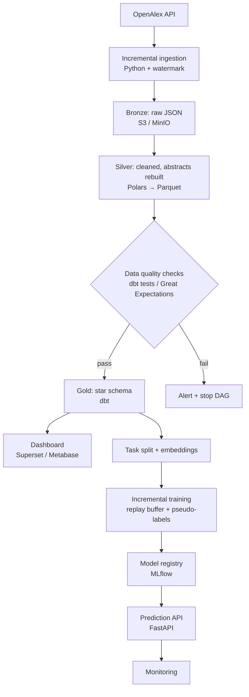

# ScholarStream: Incremental Topic Classification Pipeline for Scholarly Data

An end-to-end data platform that ingests research papers from [OpenAlex](https://openalex.org), processes them through a medallion lakehouse, and feeds a multi-label classifier that learns new research topics incrementally — without retraining from scratch.

> **Focus:** This is primarily a **data engineering** project. The ML component exists to demonstrate how a data platform serves a continuously-learning model in production-like conditions.

> **Status:** Early stage. The architecture and repository layout are defined; implementation is in progress, starting with ingestion and the bronze/silver layers.

---

## Why this project

New research papers are published every day, and the set of topics we care about grows over time. Retraining a classifier from scratch every time is expensive, and old training data may not be fully available. This project explores how to build a pipeline where:

- Data arrives **incrementally** and is processed idempotently
- Data quality is **enforced** before reaching analytics or ML consumers
- A multi-label classifier **learns new topics in stages** (multi-label class-incremental learning, MLCIL) while retaining knowledge of old ones

## Architecture



All stages are orchestrated by **Apache Airflow**.

## Tech stack

| Layer | Local | Cloud (AWS) |
|---|---|---|
| Orchestration | Airflow (Docker Compose) | Airflow on EC2 |
| Storage | MinIO | S3 + Glue Data Catalog |
| Processing | Polars | Polars on EC2 |
| Transformation | dbt + DuckDB | dbt + Athena |
| Data quality | dbt tests, Great Expectations | same |
| ML tracking | MLflow | MLflow (artifacts on S3) |
| Training | Kaggle (one-time backfill) | SageMaker Training Job (CPU) |
| Serving | FastAPI (Docker) | ECR + App Runner |
| CI/CD | GitHub Actions | GitHub Actions (OIDC → AWS) |
| Infrastructure | Docker Compose | Terraform |

## Pipeline design

### 1. Incremental ingestion
- Pulls works from the OpenAlex API, filtered by field and publication date, using cursor-based pagination
- Stores a **watermark** (last successful load date) in Postgres so each run only fetches new or updated records
- **Idempotent:** re-running the same date range produces no duplicates
- Supports **backfill** for arbitrary historical date ranges

### 2. Bronze → Silver
- Raw JSON lands in the bronze layer unchanged, partitioned by ingestion date
- Silver layer:
  - Reconstructs abstracts from OpenAlex's `abstract_inverted_index` format
  - Deduplicates records, keeping the latest version per `work_id`
  - Flattens nested topic arrays into a many-to-many table

### 3. Data quality gate
Checks run before data is promoted to gold. If any check fails, the DAG stops and sends an alert. Checks include:
- `work_id` uniqueness and not-null constraints
- Referential integrity between works and topics
- Publication dates within valid ranges
- Row-count anomaly detection between runs

### 4. Gold layer (dbt)
A star schema for analytics and ML:
- `fact_work_topics`
- `dim_works`, `dim_topics`, `dim_authors`, `dim_institutions`
- Analytical marts: topic trends by year, fastest-growing topics

### 5. ML pipeline
- **Task split:** the top-N topics are divided into sequential tasks (e.g. 10 tasks × 10 topics), simulating new topics arriving over time
- **Embeddings:** computed once with a frozen scientific-text encoder (SPECTER2); only daily new records are embedded afterwards
- **Incremental training:** a lightweight multi-label classifier trained task by task, using a replay buffer of past samples and pseudo-labels for old topics. The design is inspired by KBK (Knowing Beyond the Known)
- **Cost-aware design:** GPU is needed only for the one-time historical backfill; steady-state embedding and training run on CPU

### 6. Serving & monitoring
- FastAPI endpoint: input an abstract, get predicted topics with confidence scores
- Prediction logs are stored and monitored for distribution shifts and low-confidence rates

## Repository structure

```
.
├── dags/                  # Airflow DAGs
├── ingestion/             # OpenAlex API client, watermark logic
├── transform/             # Polars bronze → silver jobs
├── dbt_project/           # dbt models, tests, docs
├── quality/               # Great Expectations suites
├── ml/
│   ├── embeddings/        # Embedding computation
│   └── training/          # Incremental training, replay buffer
├── api/                   # FastAPI service
├── infra/                 # Terraform (AWS)
├── tests/                 # pytest unit tests
├── .github/workflows/     # CI/CD pipelines
├── docker-compose.yml     # Local stack
├── .env.example           # Environment variable template
└── .gitignore
```

## Getting started

> The local stack is being built incrementally; the commands below describe the target setup.

### Prerequisites
- Docker and Docker Compose
- Python 3.11+
- At least 8 GB RAM recommended (Airflow is memory-hungry)

### Run locally

```bash
git clone https://github.com/<your-username>/scholarstream.git
cd scholarstream
cp .env.example .env        # fill in your settings
docker compose up -d
```

Then open:
- Airflow UI: http://localhost:8080
- MinIO console: http://localhost:9001
- Dashboard: http://localhost:8088

Trigger the `openalex_ingestion` DAG to start the pipeline.

### Run tests

```bash
pytest tests/
cd dbt_project && dbt test
```

## Evaluation

Results will be reported here as the pipeline matures. The project is measured on two fronts:

- **Data platform:** volume of records processed, end-to-end daily run time, data quality test coverage, and idempotency of re-runs
- **Incremental learning:** average mAP across tasks, and mAP on old topics after the final task (to quantify forgetting) compared with a retrain-from-scratch baseline

## Design decisions & trade-offs

- **Polars over Pandas:** lazy evaluation and lower memory usage; handles millions of rows on a single machine
- **DuckDB/Athena over Spark:** at this data scale, a distributed engine adds overhead without benefit. Spark would be reconsidered at 100× scale
- **SQL (dbt) for table-to-table transforms, Python for procedural logic:** API calls, JSON parsing and abstract reconstruction in Python; modeling and tests in SQL
- **Self-hosted Airflow over MWAA:** managed Airflow is cost-prohibitive for a personal project
- **Precomputed embeddings:** decouples expensive GPU work from frequent retraining

## What would change at 100× scale

- Replace single-node Polars with Spark or distributed processing
- Move from scheduled batch to event-driven ingestion
- Partition gold tables by publication year and field for query pruning
- Run Airflow on Kubernetes with autoscaling workers
- Use a dedicated feature store for embeddings

## Limitations

- Topic labels come from OpenAlex's own automated classifier, not human annotation, so the model learns to approximate another model's labeling
- Each work has at most three topics, so labels are incomplete by nature
- Incremental tasks are simulated by splitting a fixed topic taxonomy, rather than topics genuinely emerging over time

## Acknowledgments

- Data: [OpenAlex](https://openalex.org) (CC0)
- MLCIL method inspiration: Zhang et al., *Knowing Beyond the Known: Reinforced Knowledge Specification for Multi-Label Class-Incremental Learning*

## License

MIT